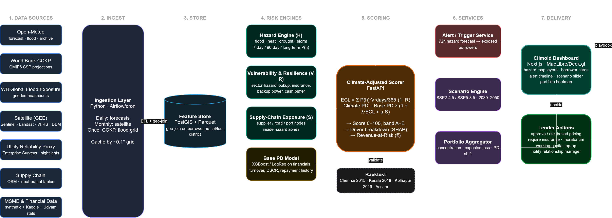
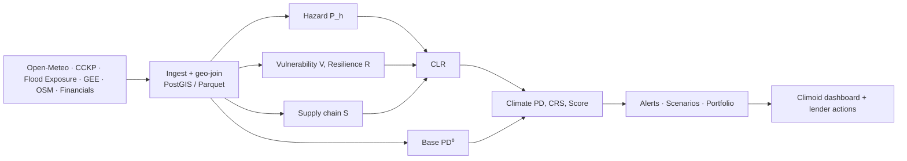

# 🌍 Climoid

<p align="center">
  
</p>

**Real-time, climate-adjusted credit risk scoring for MSMEs** (IFC FIN-05).
Climoid turns location, forecasts, satellite-derived terrain/exposure, utility reliability, supply-chain links and financials into a **climate-adjusted PD**, a **Climate Resilience Score (CRS)** and a **recommended lender action**, refreshed daily.

> _Same balance sheet, different climate exposure, different risk._

---

## Contents

1. [Pipeline at a glance](#1-pipeline-at-a-glance)
2. [Mathematical framework](#2-mathematical-framework)
   - [2.1 Notation](#21-notation)
   - [2.2 Hazard module](#22-hazard-module)
   - [2.3 Vulnerability, downtime, resilience](#23-vulnerability-downtime-resilience)
   - [2.4 Climate Loss Ratio (CLR)](#24-climate-loss-ratio-clr)
   - [2.5 Supply-chain exposure](#25-supply-chain-exposure)
   - [2.6 Base PD](#26-base-pd)
   - [2.7 Climate-adjusted PD (structural probit shift)](#27-climate-adjusted-pd-structural-probit-shift)
   - [2.8 LGD and expected credit loss](#28-lgd-and-expected-credit-loss)
   - [2.9 Scores and bands](#29-scores-and-bands)
   - [2.10 Explainability](#210-explainability)
   - [2.11 Scenario engine](#211-scenario-engine)
   - [2.12 Portfolio risk](#212-portfolio-risk)
   - [2.13 Early-intervention rule](#213-early-intervention-rule)
   - [2.14 Calibration and validation](#214-calibration-and-validation)
   - [2.15 Worked example](#215-worked-example)
   - [2.16 Assumptions and limitations](#216-assumptions-and-limitations)
3. [Data sources](#3-data-sources)
4. [Project structure and quickstart](#4-project-structure-and-quickstart)
5. [Dashboard](#5-dashboard)

---

## 1. Pipeline at a glance



**Headline equation**

$$
\boxed{\;\mathrm{PD}^{c}_i=\Phi\!\Big(\Phi^{-1}(\mathrm{PD}^{0}_i)+\lambda_i\,\mathrm{CLR}^{\mathrm{tot}}_i\Big)\;}
$$

where $\mathrm{CLR}^{\mathrm{tot}}_i$ is the borrower's expected climate-driven loss of annual revenue.

> **Naming note:** the Climate Loss Ratio (CLR) is the quantity called "ECL" in the architecture diagram. It is renamed here to avoid confusion with _expected credit loss_ (IFRS 9).

---

## 2. Mathematical framework

### 2.1 Notation

| Symbol                              | Meaning                                                                      |
| ----------------------------------- | ---------------------------------------------------------------------------- |
| $i$                                 | Borrower (MSME); $k(i)$ its sector                                           |
| $h\in\mathcal H=\{F,H,D,S\}$        | Hazard: flood, heat, drought, storm                                          |
| $t,\ \Delta$                        | Time of scoring, forecast horizon (default 7 days)                           |
| $p_{h,i}$                           | Probability of a hazard event at the location (from forecast or climatology) |
| $s_{h,i}\in[0,1]$                   | Local susceptibility: P(business disrupted given event)                      |
| $P_{h,i}=p_{h,i}\,s_{h,i}$          | Probability of a _disrupting_ event                                          |
| $I_{h,i}\in[0,1]$                   | Normalised event intensity                                                   |
| $V_{h,i}$                           | Vulnerability: fraction of revenue lost per downtime day                     |
| $D_{h,i}$                           | Expected downtime days per disrupting event                                  |
| $R_i\in[0,1)$                       | Resilience (loss absorbed by buffers)                                        |
| $S_i$                               | Supply-chain exposure                                                        |
| $\mathrm{CLR}_i$                    | Climate Loss Ratio: expected fraction of annual revenue lost                 |
| $\mathrm{PD}^0_i,\ \mathrm{PD}^c_i$ | Base and climate-adjusted 12-month probability of default                    |
| $\Phi,\ \phi,\ \sigma$              | Standard normal CDF, pdf, and logistic function $\sigma(x)=1/(1+e^{-x})$     |

---

### 2.2 Hazard module

**Generic event probability.** Given an exceedance threshold $\tau_h$ and an $M$-member forecast ensemble $X^{(m)}$ of the driving variable:

$$
p_{h,i}(t;\Delta)=\frac1M\sum_{m=1}^{M}\mathbf 1\!\left[\max_{u\in[t,t+\Delta]}X^{(m)}_{h,i}(u)\ge\tau_{h,i}\right]
$$

If only a deterministic forecast $\hat X$ is available, use the smooth fallback

$$
p_{h,i}=\sigma\!\left(\frac{\hat X_{h,i}-\tau_{h,i}}{\omega_h}\right),
$$

with scale $\omega_h$ reflecting forecast error.

**Probability of a disrupting event** (law of total probability):

$$
P_{h,i}=p_{h,i}\cdot s_{h,i}
$$

**Flood.** River discharge $Q$ (Open-Meteo flood API, GloFAS-based). Annual maxima are fitted with a Gumbel (EV-I) distribution per grid cell:

$$
F(q)=\exp\!\Big[-\exp\!\Big(-\frac{q-\mu}{\beta}\Big)\Big],\qquad
\beta=\frac{\sqrt6\,s_Q}{\pi},\qquad \mu=\bar Q-\gamma\beta,
$$

where $\gamma\approx0.5772$ is Euler's constant. The $T$-year return level is

$$
Q_T=\mu-\beta\ln\!\big[-\ln(1-1/T)\big].
$$

Set $\tau_F=Q_{T^\*}$ (default $T^\*=10$ yr), so the annual exceedance probability is $p^{\mathrm{ann}}_F=1-F(\tau_F)=1/T^\*$. The flood susceptibility combines terrain and exposure covariates:

$$
s_{F,i}=\sigma\!\Big(w_0-w_1 z(\mathrm{HAND}_i)-w_2 z(e_i)+w_3\,\mathrm{GSW}_i+w_4 z(\mathrm{FE}_i)\Big)
$$

- $\mathrm{HAND}_i$: height above nearest drainage
- $e_i$: elevation
- $\mathrm{GSW}_i\in[0,1]$: historical surface-water occurrence
- $\mathrm{FE}_i$: World Bank flood-exposure value at the chosen return period
- $z(\cdot)$: z-score standardisation

**Heat.** Driving variable is daily maximum apparent temperature $T^{a}_{\max}$. Threshold $\tau_H$ is the local 95th percentile (or an absolute value, e.g. 40 °C). An event is a heatwave of $\ge n_c$ consecutive exceedance days. Intensity:

$$
I_{H,i}=\operatorname{clip}\!\left(\frac{\hat T^{a}_{\max}-\tau_H}{T_{\mathrm{ext}}-\tau_H},0,1\right)
$$

**Drought.** Standardised Precipitation Index over $k$ months. With a gamma fit $G(\cdot;a,b)$ to accumulated precipitation and $q=P(x=0)$:

$$
\mathrm{SPI}=\Phi^{-1}\!\big(q+(1-q)\,G(x;a,b)\big)
$$

A drought event is $\mathrm{SPI}\le-1$. With forecast uncertainty $\sigma_\varepsilon$:

$$
p_{D,i}=\Phi\!\left(\frac{-1-\widehat{\mathrm{SPI}}_i}{\sigma_\varepsilon}\right)
$$

**Storm.** Wind gust (and intense-rain) exceedance via the generic logistic form with a gust threshold $v_0$ (tunable, e.g. 60 km/h):

$$
p_{S,i}=\sigma\!\left(\frac{\hat v^{\mathrm{gust}}_i-v_0}{\omega_S}\right)
$$

---

### 2.3 Vulnerability, downtime, resilience

**Vulnerability.** Sector baseline $v_{h,k}$ (lookup table), modified by borrower asset attributes $a_i$ (ground-floor premises, outdoor operations, perishable inventory, power/water dependence):

$$
V_{h,i}=\min\!\big\{1,\ v_{h,k(i)}\exp(\theta_h^{\top}a_i)\big\}
$$

**Downtime.** Intensity and grid fragility lengthen outages. With grid outage index $u_i\in[0,1]$ and backup-power flag $b_i\in\{0,1\}$:

$$
D_{h,i}(t)=D^{0}_h\,\big(1+\gamma_h I_{h,i}(t)\big)\,\big(1+\eta\,u_i(1-b_i)\big)
$$

**Resilience** (noisy-OR over independent buffers $j$: insurance, cash buffer, inventory/diversification):

$$
R_i=1-\prod_{j}\big(1-r_j\,c_{ij}\big),\qquad
c_{\mathrm{cash},i}=\min\!\Big(1,\frac{\mathrm{cash}_i}{m\cdot \mathrm{FC}_i}\Big)
$$

- $r_j\in[0,1]$: effectiveness of buffer $j$
- $c_{ij}\in[0,1]$: borrower's coverage by buffer $j$
- $\mathrm{FC}_i$: monthly fixed cost, $m$: months of cover
- Backup power enters through $D$, not $R$, to avoid double-counting.

---

### 2.4 Climate Loss Ratio (CLR)

**Loss per disrupting event** (fraction of annual revenue):

$$
\ell_{h,i}(t)=V_{h,i}\cdot\frac{D_{h,i}(t)}{365}\cdot(1-R_i)
$$

**Structural (climatological) part.** Annual rate of disrupting events $\lambda_{h,i}=-\ln\!\big(1-s_{h,i}\,p^{\mathrm{ann}}_{h,i}\big)$:

$$
\mathrm{CLR}^{\mathrm{clim}}_i=\sum_{h\in\mathcal H}\lambda_{h,i}\,\bar\ell_{h,i}
$$

where $\bar\ell_{h,i}$ is evaluated at typical intensity.

**Real-time forecast anomaly.** Replace the climatological expectation for the next 7 days by the forecast one:

$$
\mathrm{CLR}^{\mathrm{fc}}_i(t)=\sum_{h}\Big[P_{h,i}(t;7\mathrm d)-P^{\mathrm{clim}}_{h,i}(7\mathrm d)\Big]\,\ell_{h,i}(t),
\qquad P^{\mathrm{clim}}_{h,i}(7\mathrm d)\approx\tfrac{7}{365}\,s_{h,i}p^{\mathrm{ann}}_{h,i}
$$

**Total:**

$$
\boxed{\mathrm{CLR}_i(t)=\max\!\big\{0,\ \mathrm{CLR}^{\mathrm{clim}}_i(\text{scn},y)+\mathrm{CLR}^{\mathrm{fc}}_i(t)\big\}}
$$

By linearity of expectation, summing over hazards needs **no independence assumption**. Dry or calm forecasts give a negative anomaly and can lower the score.

---

### 2.5 Supply-chain exposure

For suppliers/logistics nodes $j$ with input shares $\omega_{ij}$ ($\sum_j\omega_{ij}=1$), link vulnerability $\varphi_{ij}\in[0,1]$ (e.g. fraction of the route inside a hazard zone) and substitutable-input share $\varsigma_i$:

$$
S_i=(1-\varsigma_i)\sum_{j}\omega_{ij}\,\varphi_{ij}\,\mathrm{CLR}_j
$$

Total climate loss with pass-through $\mu\in[0,1]$:

$$
\boxed{\mathrm{CLR}^{\mathrm{tot}}_i=\mathrm{CLR}_i+\mu\,S_i}
\qquad
\mathrm{RaR}_i=\mathrm{Rev}_i\cdot\mathrm{CLR}^{\mathrm{tot}}_i\ \ (\text{₹ revenue-at-risk})
$$

---

### 2.6 Base PD

Logistic scorecard on financial features $f_i$ (DSCR, leverage, current ratio, turnover growth, vintage, delinquency history). Minimise the L2-penalised log loss:

$$
\mathrm{PD}^0_i=\sigma(\beta_0+\beta^{\top}f_i),\qquad
\mathcal L(\beta)=-\frac1N\sum_i\big[y_i\ln \mathrm{PD}^0_i+(1-y_i)\ln(1-\mathrm{PD}^0_i)\big]+\alpha\|\beta\|_2^2
$$

Gradient boosting (XGBoost/LightGBM) is a drop-in alternative; the climate overlay below only needs $\mathrm{PD}^0_i$.

---

### 2.7 Climate-adjusted PD (structural probit shift)

**Merton-style link.** Distance to default $\mathrm{DD}_i=\ln(\mathrm{DSCR}_i)/\sigma_i$ with $\mathrm{PD}^0_i=\Phi(-\mathrm{DD}_i)$, hence $\mathrm{DD}_i=-\Phi^{-1}(\mathrm{PD}^0_i)$.

**Shock transmission.** Lost revenue reduces operating income by the contribution margin $\mathrm{CM}_i$ (fixed costs persist):

$$
\mathrm{NOI}^c_i=\mathrm{NOI}_i-\mathrm{CM}_i\,\mathrm{Rev}_i\,\mathrm{CLR}^{\mathrm{tot}}_i
\;\Rightarrow\;
\mathrm{DSCR}^c_i=\mathrm{DSCR}_i\big(1-\kappa_i\,\mathrm{CLR}^{\mathrm{tot}}_i\big),
\quad
\kappa_i=\frac{\mathrm{CM}_i\,\mathrm{Rev}_i}{\mathrm{NOI}_i}
$$

Using $\ln(1-x)\approx-x$:

$$
\mathrm{DD}^c_i\approx\mathrm{DD}_i-\frac{\kappa_i}{\sigma_i}\mathrm{CLR}^{\mathrm{tot}}_i
$$

**Result:**

$$
\boxed{\mathrm{PD}^c_i=\Phi\!\Big(\Phi^{-1}(\mathrm{PD}^0_i)+\lambda_i\,\mathrm{CLR}^{\mathrm{tot}}_i\Big),\qquad \lambda_i=\frac{\kappa_i}{\sigma_i}}
$$

- Always bounded in $(0,1)$ and monotone in $\mathrm{CLR}^{\mathrm{tot}}_i$.
- High operating leverage ($\kappa_i$ large, thin margins) amplifies climate shocks.
- When financial inputs are missing, use a global $\lambda_i\equiv\bar\lambda$ fitted by calibration (§2.14).

**First-order (small-shock) forms:**

$$
\mathrm{PD}^c_i\approx\mathrm{PD}^0_i+\phi\big(\Phi^{-1}(\mathrm{PD}^0_i)\big)\,\lambda_i\,\mathrm{CLR}^{\mathrm{tot}}_i
\;=\;\mathrm{PD}^0_i\big(1+\varepsilon_i\,\mathrm{CLR}^{\mathrm{tot}}_i\big),
\quad
\varepsilon_i=\frac{\lambda_i\,\phi(\Phi^{-1}(\mathrm{PD}^0_i))}{\mathrm{PD}^0_i}
$$

This recovers the simple multiplicative rule $\mathrm{PD}^c=\mathrm{PD}^0(1+\lambda'\,\mathrm{CLR})$ with a _state-dependent_ elasticity $\varepsilon_i$.

**Sensitivity:** $\dfrac{\partial\,\mathrm{PD}^c_i}{\partial\,\mathrm{CLR}^{\mathrm{tot}}_i}=\lambda_i\,\phi\!\big(\Phi^{-1}(\mathrm{PD}^0_i)+\lambda_i\mathrm{CLR}^{\mathrm{tot}}_i\big)$

---

### 2.8 LGD and expected credit loss

Collateral damage raises loss given default. With collateral damage fractions $A_{h,i}$ and sensitivity $\psi$:

$$
\mathrm{LGD}^c_i=\min\Big\{1,\ \mathrm{LGD}^0_i+\psi\sum_h P_{h,i}\,A_{h,i}\Big\}
$$

$$
\mathrm{EL}^c_i=\mathrm{PD}^c_i\cdot\mathrm{LGD}^c_i\cdot\mathrm{EAD}_i,\qquad
\Delta\mathrm{EL}_i=\mathrm{EL}^c_i-\mathrm{EL}^0_i
$$

Use $\Delta\mathrm{EL}_i$ for **risk-based pricing**, in basis points of loan:

$$
\Delta r_i\approx\frac{\Delta\mathrm{EL}_i}{\mathrm{EAD}_i}\times10^{4}
$$

---

### 2.9 Scores and bands

**Credit-style score** (points-to-double-odds scaling, defaults $S_0=600$ at good:bad odds $O_0=50{:}1$, $\mathrm{PDO}=40$):

$$
S(\mathrm{PD})=S_0+\frac{\mathrm{PDO}}{\ln 2}\,\ln\!\left(\frac{(1-\mathrm{PD})/\mathrm{PD}}{O_0}\right),\qquad
\Delta S_i=S(\mathrm{PD}^c_i)-S(\mathrm{PD}^0_i)
$$

$\Delta S_i$ is the **"climate penalty"** shown on every borrower card.

**Climate Resilience Score** (0–100, higher is safer), with $\epsilon_0=0.05$ (5% of annual revenue at risk maps to about 37):

$$
\mathrm{CRS}_i=100\cdot\exp\!\Big(-\frac{\mathrm{CLR}^{\mathrm{tot}}_i}{\epsilon_0}\Big)
$$

| Band | CRS   | Meaning                                     |
| ---- | ----- | ------------------------------------------- |
| A    | ≥ 80  | Low climate risk                            |
| B    | 65–80 | Moderate                                    |
| C    | 50–65 | Elevated: price/condition                   |
| D    | 35–50 | High: insurance or restructuring conditions |
| E    | < 35  | Severe: escalate                            |

---

### 2.10 Explainability

**Climate part (exact, additive).** In probit space the shift is linear in the CLR components:

$$
\Delta z_i=\lambda_i\,\mathrm{CLR}^{\mathrm{tot}}_i=\sum_{h}\lambda_i\,\mathrm{CLR}_{h,i}+\lambda_i\,\mu\,S_i
$$

Driver share of hazard $h$: $\ \pi_{h,i}=\mathrm{CLR}_{h,i}/\mathrm{CLR}^{\mathrm{tot}}_i$. These feed the "why this score" bar chart.

**Financial part.** SHAP values $\phi_f$ for the base PD model, with $\sum_f\phi_f=\mathrm{logit}(\mathrm{PD}^0_i)-\mathbb E[\mathrm{logit}(\mathrm{PD}^0)]$.

---

### 2.11 Scenario engine

**Delta-change method.** CCKP (CMIP6) supplies, for scenario $s\in\{\text{SSP2-4.5},\text{SSP5-8.5}\}$ and period $y$, a warming $\Delta T_{s,y}$ and precipitation change $\delta P_{s,y}$.

- **Heat:** shift the distribution, $T'=T+\Delta T_{s,y}$, then recompute $p^{\mathrm{ann}}_H=P(T'>\tau_H)$.
- **Flood / extreme rain:** scale the Gumbel parameters with the Clausius–Clapeyron-type factor

$$
\mu'=\mu\,(1+\alpha\,\Delta T_{s,y}),\quad
\beta'=\beta\,(1+\alpha\,\Delta T_{s,y}),\quad
p'^{\mathrm{ann}}_F=1-F(\tau_F;\mu',\beta')
$$

with $\alpha\approx0.07\,\mathrm{K}^{-1}$ (assumption, tunable).

- **Drought:** rescale precipitation, $x'=x\,(1+\delta P_{s,y})$, and recompute SPI and $p_D$.

Recompute $\mathrm{CLR}^{\mathrm{clim}}(s,y)\to\mathrm{PD}^c(s,y)\to\Delta\mathrm{EL}(s,y)$ for the scenario slider.

---

### 2.12 Portfolio risk

**Portfolio expected loss and concentration** (districts $d$):

$$
\mathrm{EL}^c=\sum_i\mathrm{EL}^c_i,\qquad
\mathrm{HHI}=\sum_d\Big(\frac{\mathrm{EL}^c_d}{\mathrm{EL}^c}\Big)^2
$$

**Climate-VaR via Gaussian copula.** Spatial climate factor $Z\sim\mathcal N(0,C)$ with district-level correlation decaying with distance:

$$
C_{dd'}=\exp\!\big(-\mathrm{dist}(d,d')/\ell\big)
$$

Latent variable for borrower $i$ in district $g(i)$, with asset correlation $\rho$:

$$
A_i=\sqrt{\rho}\,Z_{g(i)}+\sqrt{1-\rho}\,\varepsilon_i,\qquad
\text{default}_i=\mathbf 1\big[A_i\le\Phi^{-1}(\mathrm{PD}^c_i)\big]
$$

$$
L=\sum_i\mathrm{EAD}_i\,\mathrm{LGD}^c_i\,\text{default}_i,\qquad
\mathrm{VaR}_\alpha=\inf\{x:P(L\le x)\ge\alpha\},\quad
\mathrm{ES}_\alpha=\mathbb E[L\mid L\ge\mathrm{VaR}_\alpha]
$$

Estimate by Monte Carlo and report $\Delta\mathrm{VaR}_{99}=\mathrm{VaR}_{99}(\mathrm{PD}^c)-\mathrm{VaR}_{99}(\mathrm{PD}^0)$ as the portfolio's climate add-on.

---

### 2.13 Early-intervention rule

**Priority score** (exposure-weighted jump in expected loss since yesterday):

$$
\mathrm{prio}_i(t)=\mathrm{EAD}_i\,\mathrm{LGD}_i\big[\mathrm{PD}^c_i(t)-\mathrm{PD}^c_i(t-1\mathrm d)\big]
$$

**Trigger:** raise an alert if

$$
\max_h P_{h,i}(t;72\mathrm h)\ge p^\*\quad\text{or}\quad \mathrm{prio}_i(t)\ge\tau_a
$$

Alerts are ranked by $\mathrm{prio}_i$, with a cooldown to avoid repeated notifications.

| Condition                          | Suggested action                                              |
| ---------------------------------- | ------------------------------------------------------------- |
| Good $\mathrm{PD}^0$, CRS band C–D | Approve with pricing $+\Delta r_i$ or require insurance       |
| Forecast alert, 72 h               | Notify relationship manager, pre-emptive working-capital line |
| Post-event satellite confirmation  | Moratorium or restructuring review                            |
| Thin file, CRS band A              | Candidate for inclusion (climate-resilient)                   |

---

### 2.14 Calibration and validation

**Parameter set** $\Theta=(w,\theta,D^0,r,\bar\lambda,\mu,\psi)$, fitted by penalised maximum likelihood towards expert priors $\Theta_0$:

$$
\hat\Theta=\arg\min_\Theta\ -\sum_i\big[y_i\ln \mathrm{PD}^c_i(\Theta)+(1-y_i)\ln(1-\mathrm{PD}^c_i(\Theta))\big]+\gamma\|\Theta-\Theta_0\|^2
$$

**Metrics**

| Target                | Metric                                                |
| --------------------- | ----------------------------------------------------- |
| Base PD ranking       | AUC, KS                                               |
| PD calibration        | Brier score, reliability diagram, Hosmer-Lemeshow     |
| Hazard forecast skill | $\mathrm{BS}=\frac1N\sum(p-o)^2$, reliability diagram |
| Event backtest        | Cumulative abnormal $\Delta\mathrm{PD}$ (below)       |
| Parameter robustness  | Sobol / one-at-a-time sensitivity of $\mathrm{PD}^c$  |

**Event study.** For a historical event $e$ (e.g. Chennai 2015, Kerala 2018, Kolhapur–Sangli 2019, Assam floods) with affected set $\mathcal A$ and control set $\mathcal C$:

$$
\mathrm{CAR}_e(\tau)=\frac{1}{|\mathcal A|}\sum_{i\in\mathcal A}\Delta\mathrm{PD}_i(t_e-\tau)-\frac{1}{|\mathcal C|}\sum_{i\in\mathcal C}\Delta\mathrm{PD}_i(t_e-\tau)
$$

The score is useful if $\mathrm{CAR}_e(\tau)$ is significantly positive for lead times $\tau>0$ (the warning precedes the event).

---

### 2.15 Worked example

Two textile MSMEs with **identical financials**: $\mathrm{PD}^0=3\%$ (so $\Phi^{-1}(0.03)=-1.881$), same loan size, $\lambda=12$ (e.g. $\kappa\approx2.9$, $\sigma\approx0.25$).

|                                      | **A: riverside, grid-fragile** | **B: elevated, backed-up** |
| ------------------------------------ | ------------------------------ | -------------------------- |
| $\mathrm{CLR}^{\mathrm{tot}}$        | 2.4%                           | 0.3%                       |
| Probit shift $\lambda\,\mathrm{CLR}$ | +0.288                         | +0.036                     |
| $\mathrm{PD}^c=\Phi(\cdot)$          | **5.56%**                      | **3.25%**                  |
| Score $S$ (base 575)                 | **538** (−37)                  | **570** (−5)               |
| $\mathrm{CRS}$                       | 61.9 → band C                  | 94.2 → band A              |

One component of A's CLR, today's flood forecast: 12 of 51 ensemble members exceed $Q_{10}$, so $p_F=0.235$; with $s_F=0.6$, $P_F=0.141$. Using $V_F=0.5$, $D_F=14$ days, $R=0.2$ and subtracting the climatological 7-day baseline ($\approx0.001$):

$$
\mathrm{CLR}^{\mathrm{fc}}_{F}\approx0.140\times0.5\times\frac{14}{365}\times0.8\approx0.21\%\ \text{of annual revenue}
$$

That is the daily-updating part of A's 2.4%. The other drivers (heat, power fragility, supply chain, climatology) make up the rest.

---

### 2.16 Assumptions and limitations

- **Proxies.** Utility reliability ($u_i$) and supply links ($\omega_{ij},\varphi_{ij}$) are proxy-based (Enterprise Surveys, nightlights, OSM). Replace with lender data when available.
- **Synthetic financials/defaults** for the demo. $\lambda,\mu,\psi$ are priors until calibrated on real outcomes.
- **Flood exposure** from the World Bank grid is a _regional_ headcount prior. Micro-level risk comes from HAND, elevation and surface-water occurrence.
- **Delta-change scenarios** shift means and scales only. Changes in variability or event clustering are not modelled.
- **Stationarity:** thresholds and Gumbel fits use historical climatology and may lag a changing climate.
- **Annual horizon:** $\mathrm{PD}^c$ is a 12-month PD. Short-lived forecast spikes are bounded by the linear anomaly term.
- Decision-support overlay only. It augments, not replaces, existing credit policy and human judgement.

---

## 3. Data sources

| Layer                                                                    | Source                                                                                                                                            | Cadence         |
| ------------------------------------------------------------------------ | ------------------------------------------------------------------------------------------------------------------------------------------------- | --------------- |
| Forecast, flood discharge, history                                       | [Open-Meteo](https://open-meteo.com/)                                                                                                             | Daily           |
| CMIP6 projections (SSP2-4.5, SSP5-8.5)                                   | [World Bank CCKP](https://climateknowledgeportal.worldbank.org/download-data)                                                                     | One-time        |
| Flood exposure grid                                                      | [WB Global Flood Exposure](https://datacatalog.worldbank.org/search/dataset/0062763/global-flood-exposure-gridded-exposure-headcounts-by country) | One-time        |
| Elevation, HAND, surface water, SAR flood extent, LST, NDVI, nightlights | Google Earth Engine (SRTM, JRC GSW, Sentinel-1/2, Landsat, VIIRS)                                                                                 | Monthly / event |
| Utility reliability proxy                                                | WB Enterprise Surveys, VIIRS                                                                                                                      | Periodic        |
| Supply chain and logistics                                               | OpenStreetMap, input-output tables                                                                                                                | Static          |
| MSME financials                                                          | Synthetic + public loan datasets + Udyam statistics                                                                                               | Static          |
| Backtest events                                                          | Dartmouth Flood Observatory, NDMA/IMD reports                                                                                                     | Static          |

---

## 4. Project structure and quickstart

Planned layout:

```
climoid/
├── data/            # raw + processed (Parquet, GeoTIFF)
├── ingest/          # open_meteo.py, gee_export.py, cckp.py, synth_borrowers.py
├── models/
│   ├── hazard.py        # §2.2  Gumbel, SPI, ensemble exceedance
│   ├── vulnerability.py # §2.3  V, D, R
│   ├── clr.py           # §2.4–2.5
│   ├── base_pd.py       # §2.6
│   ├── climate_pd.py    # §2.7–2.9
│   ├── scenarios.py     # §2.11
│   └── portfolio.py     # §2.12 copula VaR/ES
├── api/             # FastAPI: /score, /alerts, /scenario, /portfolio
├── dashboard/       # Next.js + MapLibre/Deck.gl
├── notebooks/       # calibration, backtests
└── README.md
```

```bash
git clone <repo> && cd climoid
python -m venv .venv && source .venv/bin/activate
pip install -r requirements.txt
python ingest/synth_borrowers.py --n 500 --regions pune guwahati jaipur chennai
python ingest/open_meteo.py --daily
uvicorn api.main:app --reload
```

**Windows one-click:** double-click `start-climoid.bat` — installs dependencies on first run, starts the voice + AI backend (`:3001`) and the console (`:3000`), and opens your browser.

Example request:

```http
POST /score
{ "borrower_id": "MSME-0142", "horizon_days": 7, "scenario": "SSP2-4.5", "year": 2040 }
```

Example response fields: `pd_base`, `pd_climate`, `score_base`, `score_climate`, `crs`, `band`, `clr_by_hazard`, `revenue_at_risk_inr`, `recommended_action`.

---

## 5. Dashboard

Climate-first views: hazard-layer map with satellite flood extent, borrower cards (financial vs climate-adjusted score, driver breakdown), 7-day alert timeline, scenario slider (SSP × year), and portfolio heatmap with $\Delta\mathrm{VaR}$ and concentration (HHI).

---

**License:** MIT (or as required by the hackathon).
**Disclaimer:** Prototype for decision support. Parameters are priors pending calibration on real outcome data.
